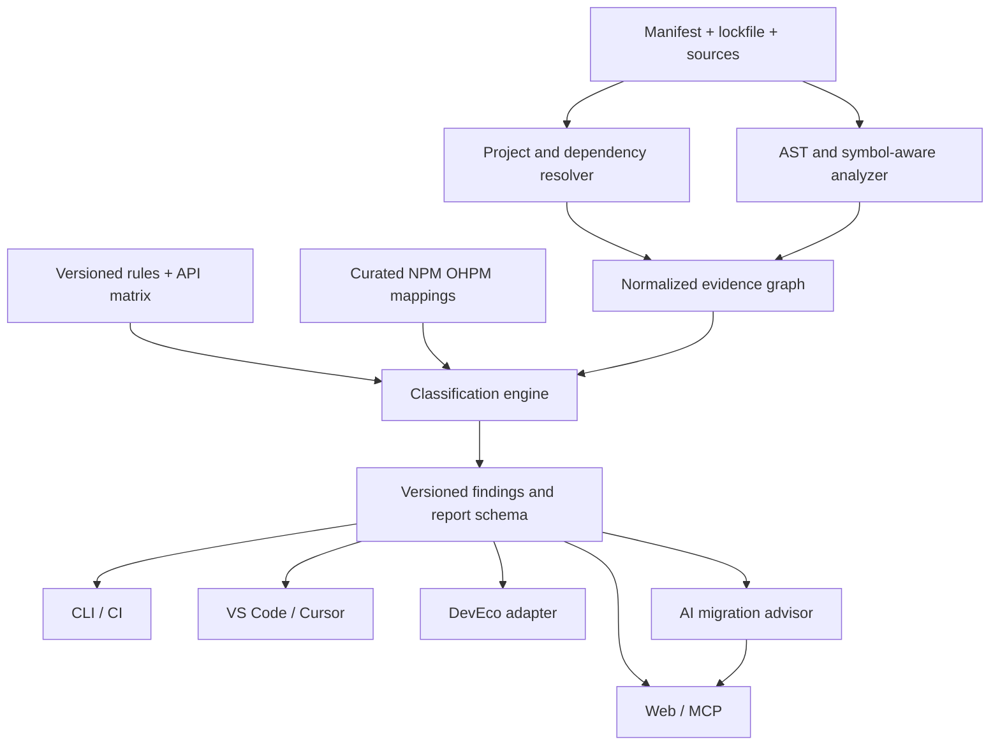

# Architecture · ArkCompat

**Decision:** TypeScript First, deterministic evidence-backed core, multi-entry adapters. Rust may be introduced later only for measured bottlenecks or distribution needs.

## Context and constraints

Compatibility is **not** a binary package-name lookup. A package may work in ArkWeb but not ArkTS, require HarmonyOS system capabilities/permissions, support only selected APIs, or be available as a port without an OHPM package.

### Logical flow



## Functional boundaries

1. **Dependency analyzer**: manifest and lockfile adapters, workspace graph, aliases, peer/optional, resolved versions. Do not claim transitive completeness when a lockfile cannot be parsed.
2. **Source analyzer**: JS/TS parser + program/symbol resolution where needed; imports and API calls; explicit unknown handling for dynamic patterns. ETS support through a validated adapter/toolchain, not an assumption that the TS parser fully understands ArkTS.
3. **Environment profiles**: runtime (ArkTS native, ArkWeb, RN, etc.), device form factor if relevant, HarmonyOS release/API version, system capability, permissions and target build mode.
4. **Rules engine**: stable `ruleId`, applicability predicates, severity and evidence; deterministic precedence; versioned rules and a reproducible classification decision tree.
5. **Knowledge module**: source and target package IDs, exact/semver ranges, mapping kind, functionality covered, status, evidence links, last-verified date, source license and reviewers.
6. **Verification adapters**: optional compile/test/runtime evidence, with toolchain and device/SDK metadata. Unable to verify ≠ compatible.
7. **Reports/contract**: JSON is source of truth; SARIF for IDE/CI, Markdown/HTML for humans; stable schema version and backward-compatibility tests.
8. **AI advisor**: retrieval-constrained explanations and suggested migration tasks, opt-in external calls, cannot fabricate replacement citations. A recommendation is never promoted to verified without independent proof.

## Data contracts (proposed)

```ts
type Runtime = 'arkts' | 'arkweb' | 'react-native' | 'unknown';
type Status =
  | 'verified-compatible' | 'verified-incompatible'
  | 'conditional' | 'potential-risk' | 'unknown' | 'not-applicable';
type EvidenceTier = 'rule-static' | 'build-verified' | 'runtime-verified';
interface TargetProfile {
  os: 'HarmonyOS';
  release: string;          // e.g. 6.0.0
  apiLevel?: number;
  runtime: Runtime;
  device?: string;
}
interface Finding {
  ruleId: string;
  status: Status;
  tier: EvidenceTier;
  severity: 'critical' | 'high' | 'medium' | 'low' | 'info';
  package?: { name: string; version?: string };
  location?: { path: string; line: number; column: number };
  target: TargetProfile;
  evidence: Array<{ kind: string; uri?: string; snapshot?: string }>;
  explanation: string;
  replacements?: Array<{ name: string; versionRange?: string; mappingId: string }>;
}
```

This is the **proposal**, not an implemented API. Freeze schemas only after fixtures and real integration checks.

## Deployment / execution

- CLI and IDE: local-first; do not upload source by default; process isolated workspaces with bounded resources.
- Web: first prefer local report import/view rather than remote execution of untrusted sources.
- MCP: structured tools e.g. `compat.scan`, `compat.explain`, `compat.find_replacement`, `compat.query_knowledge`, with explicit user approval for external access.
- CI: pinned core/rules/knowledge versions; annotate changed risk findings; never exfiltrate secrets through scan artifacts.
- DevEco: spike extension SDK/distribution constraints in M0. Prefer a thin plugin bridging the core by JSON-RPC/stdio or stable process/HTTP protocol; do **not** assume the VS Code extension API runs inside DevEco.

## Key nonfunctional requirements

- **Provenance:** rule ID + version + source snapshot + target profile in every finding.
- **Determinism:** same input and pinned snapshots must produce semantically identical findings.
- **Privacy:** ignore files by policy, prevent leaking tokens/path secrets, explicit opt-in for external model calls.
- **Performance:** measure medium and large repos; incremental caching only after correctness.
- **Safety:** no arbitrary lifecycle script execution during analysis; third-party packages are untrusted.
- **Testability:** dependency injection for registry adapters and AI clients; offline fixtures.

## Open technology decisions

Exact TS analyzer (Compiler API / typescript-eslint / others), OHPM registry access strategy, plugin SDK feasibility, package licensing, schema versioning policy, persistence engine and deployment hosting. Capture ADRs in [DECISIONS](DECISIONS.md) rather than inventing guarantees.

## Design invariants

The UI never determines compatibility; knowledge cannot override evidence without policy; AI explanations are always clearly labeled; missing same-named package is never proof of incompatibility; release checks run from fixed versioned snapshots.
